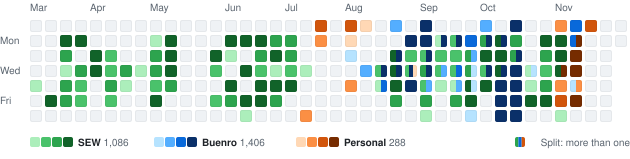

### Hi, I'm Justin

Justin Diaz is a results-driven Lead Product Designer with 14 years in SaaS, Ad Tech, Creator/Influencer Marketing, and Utilities & Electric Vehicles.

Portfolio: [idiaz.design](https://idiaz.design)

#### All my 2026 commits

Every commit I authored in 2026, split by where the work was: SEW, Buenro and personal projects. A day with work in more than one is split. Counted once each from local git history; bots left out.

---

### SEW: Design system, design ops & prototyping

With no design-system team, I contributed to base 2.0 and built the tools around it: a versioned component library kept in sync with Figma, drift checks, and Prototype Studio.

The code is private to SEW, so it doesn't show on this profile. My SEW account was [@justin-sew](https://github.com/justin-sew).

#### 2026 on GitHub

Every commit I authored across 10 SEW repos, counted once, from local git history. Bots and automatic backups left out.

- **1,086** commits, Mar 5 → Nov 2026
- **102** active days; the busiest had 52 commits
- **229** pull requests opened, 213 merged
- **927** downloads of the published component library package
- **600+** of my 1,086 SEW commits list Claude as co-author (Mar 5 → Nov 2026)

Most active: the component library (563 commits), Prototype Studio (209) and the SmartCX build (138).

**[Read the case study →](https://idiaz.design/sew-design-system)**
